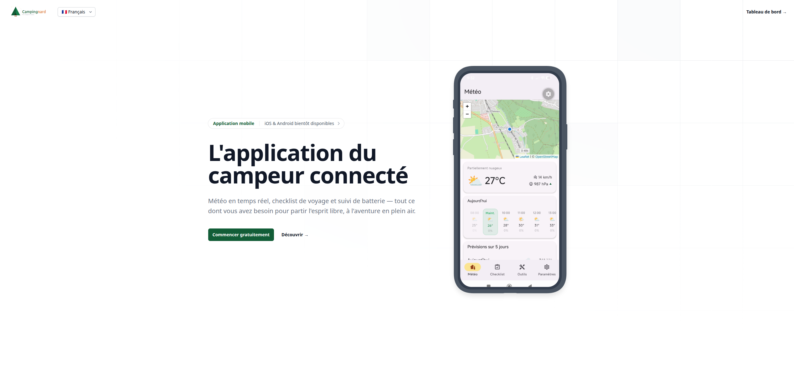
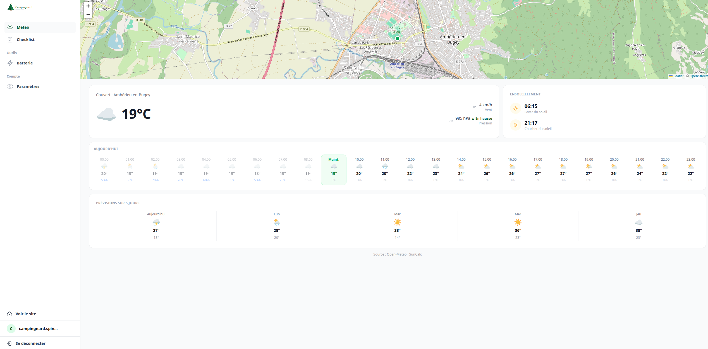
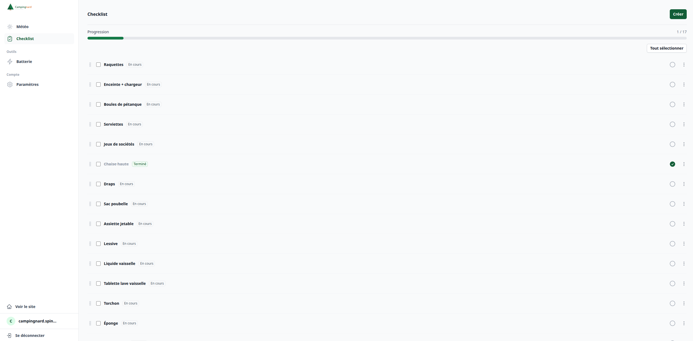

# Campingnard — application web

**L'application du campeur connecté** : météo en temps réel, checklist de voyage et suivi de
batterie.

Application [Symfony](https://symfony.com), servie par [FrankenPHP](https://frankenphp.dev) et
[Caddy](https://caddyserver.com/) via Docker. Expose également l'API JSON consommée par
l'[application mobile Campingnard](../campingnard-mobile).

## Aperçu

  

  
  

## Fonctionnalités

Toute l'application est protégée par connexion.

- **Météo** — position géolocalisée sur carte (OpenStreetMap/Leaflet), conditions actuelles,
  prévisions heure par heure et à 5 jours, lever/coucher du soleil ([Open-Meteo](https://open-meteo.com) /
  SunCalc).
- **Checklist** — création d'articles, génération à partir de préréglages, statut par article,
  actions groupées (statut / suppression), réorganisation par glisser-déposer, filtres, édition.
- **Batterie** — rappel de recharge configurable (activation + fréquence en jours).
- **Paramètres** — changement de langue (FR/EN), suppression de compte.
- **Compte** — inscription avec vérification d'email, mot de passe oublié / réinitialisation.

## Getting Started

1. If not already done, [install Docker Compose](https://docs.docker.com/compose/install/) (v2.10+)
2. Run `docker compose build --pull --no-cache` to build fresh images
3. Run `docker compose up --wait` to set up and start a fresh Symfony project
4. Open `https://localhost` in your favorite web browser and [accept the auto-generated TLS certificate](https://stackoverflow.com/a/15076602/1352334)
5. Run `docker compose down --remove-orphans` to stop the Docker containers.

## Docs

1. [Options available](docs/options.md)
2. [Support for extra services](docs/extra-services.md)
3. [Deploying in production](docs/production.md)
4. [Debugging with Xdebug](docs/xdebug.md)
5. [TLS Certificates](docs/tls.md)
6. [Using MySQL instead of PostgreSQL](docs/mysql.md)
7. [Using Alpine Linux instead of Debian](docs/alpine.md)
8. [Using a Makefile](docs/makefile.md)
9. [Troubleshooting](docs/troubleshooting.md)
10. [Using AI Coding Agents](docs/agents.md)

## License

Ce projet est distribué sous licence MIT.
